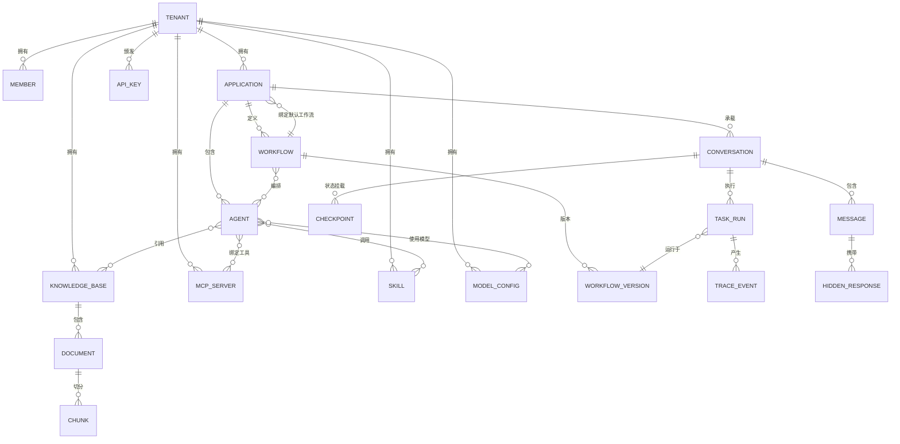

# 通用智能体平台 — 项目需求文档（PRD）

| 项目名称 | 通用智能体平台（General-Purpose Agent Platform） |
|---|---|
| 文档版本 | v1.1 |
| 文档状态 | 草稿（待评审） |
| 创建日期 | 2026-10-24 |
| 技术栈 | Python + LangGraph + FastAPI / React 18 + TypeScript |

---

## 1. 项目背景与目标

### 1.1 背景

随着大语言模型（LLM）能力的成熟，企业和团队普遍需要在**同一套基础设施**上承载多个 AI 应用，而不是为每个应用单独搭建一套系统。这种诉求催生了对一个**通用、可复用、可配置**的智能体平台的强烈需求。

### 1.2 目标

构建一个**通用智能体平台**，具备以下核心能力：

1. **多租户（Multi-Tenancy）**：一套平台服务多个租户，数据与配置严格隔离。
2. **多应用（Applications）**：一个租户下可创建多个 AI 应用。
3. **多智能体（Agents）**：一个应用下可配置多个 Agent。
4. **多工作流（Workflows）**：一个应用可定义多个工作流，**一个应用绑定一个默认工作流**；工作流支持**智能路由**，在多 Agent 间动态选择执行路径。
5. **扩展能力**：支持 MCP 服务、Skills、知识库（RAG）。
6. **智能编排**：基于 **LangGraph** 实现有状态、可观测、可人工介入的图编排。
7. **可视化管理台**：基于 **React** 的现代化管理台，具备**高度智能化的交互动效**。
8. **隐藏返回格式**：支持不展示在聊天框内、仅供前端触发特定操作的结构化返回。

### 1.3 非目标（本阶段不包含）

- 自研大模型训练。
- 面向最终 C 端用户的聊天 UI（本阶段聚焦平台与管理台，C 端接入通过 SDK/API 提供）。
- 付费计费体系（预留租户配额字段，但不实现支付）。

---

## 2. 用户角色与权限

| 角色 | 说明 | 权限范围 |
|---|---|---|
| **平台管理员（Platform Admin）** | 平台运营方 | 管理所有租户、全局配置、系统监控 |
| **租户管理员（Tenant Admin）** | 单个租户的管理者 | 管理本租户的应用、成员、配额、密钥 |
| **应用开发者（App Developer）** | 租户内的应用负责人 | 配置 Agent、工作流、知识库、MCP、Skills |
| **普通成员（Member）** | 租户内的普通使用者 | 查看配置、查看运行记录（受授权限制） |

权限模型采用 **RBAC + 租户作用域**，所有访问必须携带租户上下文。

---

## 3. 核心概念模型

```
平台 Platform
 └── 租户 Tenant (1:N)
      ├── 成员 Member (1:N)
      ├── 知识库 KnowledgeBase (1:N)
      ├── MCP 服务 McpServer (1:N)
      ├── Skill 集合 Skill (1:N)
      └── 应用 Application (1:N)          ← 业务入口（隔离边界）
           ├── Agent (1:N)                ← 应用内可复用的智能体
           ├── 工作流 Workflow (1:N)       ← 编排定义（图模板）
           │     └── 节点/路由（LangGraph 图）
           ├── 默认工作流绑定 (1:1)
           └── 会话 Conversation (1:N)     ← 真正的运行时隔离单元
                 └── 消息 Message (1:N)
                       └── 绑定工作流实例（运行时状态）
```

### 3.1 关系约束

- **应用（Application）是业务入口与隔离边界**，不是会话容器。一个应用 = 一个独立的产品/场景（如"客服机器人""合同助手"）。
- **一个应用绑定一个默认工作流（Workflow）**，用于处理该应用的默认请求入口。
- **会话（Conversation）是运行时隔离单元**，隶属于应用之下，携带 `user_id`（终端用户）+ `conversation_id`（会话），是 LangGraph 状态持久化（checkpoint）的挂载点。
- 一个应用可拥有多个工作流（用于 A/B、场景分流），但同一时刻只有一个被绑定为默认。
- 一个 Agent 可被多个工作流复用。
- 一个工作流可编排多个 Agent，并通过**智能路由**动态选择执行路径。
- 知识库、MCP、Skill 是租户级资源，可被该租户下任意应用/Agent 引用。

### 3.2 会话隔离模型（重点）

会话隔离是本平台的多租户数据隔离的**最后一环**，四层隔离边界如下：

```
租户 Tenant  ── 应用 Application ── 会话 Conversation ── 消息 Message
   │                │                    │
   │                │                    └── conversation_id + user_id 唯一标识
   │                └── 应用级配置/资源隔离（Agent/工作流/密钥/配额）
   └── 租户级数据/配置严格隔离（数据库级 + 权限级）
```

| 层级 | 隔离键 | 隔离内容 | 隔离方式 |
|---|---|---|---|
| 租户层 | `tenant_id` | 数据、配置、成员、配额、密钥 | 数据库行级 + 中间件强制注入 |
| 应用层 | `app_id` | Agent、工作流、知识库引用、调用凭证 | 应用作用域 |
| 会话层 | `conversation_id` + `user_id` | 对话历史、LangGraph checkpoint 状态 | 会话作用域，checkpoint 按会话持久化 |
| 消息层 | `message_id` | 单条消息、隐藏返回、tool 调用 | 消息作用域 |

**核心约束：**

- 每个请求必须同时携带 `tenant_id`、`app_id`、`conversation_id`（或 `user_id`）上下文，缺一不可。
- LangGraph 的 checkpoint（工作流运行时状态）以**会话**为单位持久化，保证同一会话内多轮上下文连续，不同会话之间状态完全隔离、互不可见。
- 同一 `user_id` 可拥有多个 `conversation_id`（多会话并行），彼此状态独立。
- 跨租户、跨应用、跨会话的访问一律在网关/中间件层被拒绝。

---

## 4. 功能需求

### 4.1 多租户管理

| 编号 | 需求 | 优先级 |
|---|---|---|
| FR-T-01 | 支持创建、编辑、停用、删除租户 | P0 |
| FR-T-02 | 租户级配额管理（应用数、Agent 数、存储、调用量） | P0 |
| FR-T-03 | 租户数据严格隔离，禁止跨租户访问 | P0 |
| FR-T-04 | 租户级密钥管理（API Key 加密存储） | P0 |
| FR-T-05 | 租户成员管理与角色分配 | P0 |

### 4.2 应用管理

| 编号 | 需求 | 优先级 |
|---|---|---|
| FR-A-01 | 创建、编辑、删除 AI 应用 | P0 |
| FR-A-02 | 应用基础配置（名称、描述、图标、模型默认参数） | P0 |
| FR-A-03 | 应用绑定默认工作流（一对一） | P0 |
| FR-A-04 | 应用级访问凭证与调用入口（SDK/API） | P1 |
| FR-A-05 | 应用级运行统计（调用量、耗时、错误率） | P1 |

### 4.3 会话管理（Conversation）

> 会话是应用之下的**运行时隔离单元**，是多租户数据隔离的最后一环。应用绑定工作流后，每一次终端用户交互都在一个独立的会话上下文中进行。

| 编号 | 需求 | 优先级 |
|---|---|---|
| FR-CV-01 | 会话以 `app_id + user_id + conversation_id` 唯一标识，隔离对话历史与运行时状态 | P0 |
| FR-CV-02 | 会话创建、查询、删除、超时归档 | P0 |
| FR-CV-03 | LangGraph checkpoint 以会话为单位持久化，保证多轮上下文连续、跨会话状态互不可见 | P0 |
| FR-CV-04 | 同一 `user_id` 支持多个并发会话，状态相互独立 | P0 |
| FR-CV-05 | 会话级上下文窗口管理与历史消息分页 | P1 |
| FR-CV-06 | 会话级访问控制（仅会话所属终端用户/授权管理员可读） | P0 |
| FR-CV-07 | 会话级配额（单会话 token、时长、消息数上限） | P1 |

#### 4.3.1 会话与任务状态机（重点）

> 「结束态必达」的前提是状态机明确定义。每个会话内的**一次执行（任务 run）**须遵循以下生命周期，禁止出现无定义的中间态。

```
                 ┌─────────────────────────────────────────┐
                 │               终态（结束态必达）            │
                 │  completed / failed / degraded /         │
                 │  timed_out / cancelled / escalated       │
                 └─────────────────────────────────────────┘
                                  ▲  ▲  ▲  ▲  ▲  ▲
                                  │  │  │  │  │  │
created ──▶ running ──▶ (waiting_human) ──▶ ...
              │  ▲
              │  └── retry ──┐
              ▼             │
          failed/timed_out ─┘
```

**任务状态定义：**

| 状态 | 说明 | 可迁移到 |
|---|---|---|
| `created` | 任务已创建，尚未开始 | `running` |
| `running` | 图执行中 | `waiting_human`、各终态 |
| `waiting_human` | 等待人工介入确认/输入 | `running`（继续）、`cancelled` |
| `completed` | 正常完成（终态） | — |
| `degraded` | 降级完成（如主模型失败走规则/小模型）（终态） | — |
| `failed` | 执行失败（终态） | — |
| `timed_out` | 超时终止（终态） | — |
| `cancelled` | 人工/主动取消（终态） | — |
| `escalated` | 升级转人工（终态） | — |

**状态机约束：**

- 所有状态迁移必须可观测（写入 trace/审计）。
- 进入 `waiting_human` 必须带超时，超时后自动流转（如 `escalated` 或 `timed_out`）。
- 任何非终态任务在进程崩溃/重启后，可通过 checkpoint 恢复并继续。
- 终态不可逆；如需重试，创建新 run 而非原地改状态。

### 4.4 Agent 管理

| 编号 | 需求 | 优先级 |
|---|---|---|
| FR-G-01 | 创建、编辑、删除 Agent | P0 |
| FR-G-02 | Agent 配置：系统提示词（System Prompt）、模型、温度、上下文长度 | P0 |
| FR-G-03 | Agent 绑定工具集（MCP / Skill） | P0 |
| FR-G-04 | Agent 绑定知识库（用于 RAG） | P0 |
| FR-G-05 | Agent 支持多轮记忆与自定义记忆策略 | P1 |
| FR-G-06 | Agent 版本管理与灰度 | P2 |

### 4.5 工作流管理（核心）

| 编号 | 需求 | 优先级 |
|---|---|---|
| FR-W-01 | 可视化编排工作流（拖拽节点、连线） | P0 |
| FR-W-02 | 基于 LangGraph 的图执行引擎 | P0 |
| FR-W-03 | **智能路由**：在多 Agent 间根据语义/规则动态选择执行路径 | P0 |
| FR-W-04 | 支持条件分支、循环、并行、聚合节点 | P0 |
| FR-W-05 | 支持状态持久化与断点续跑（checkpoint） | P0 |
| FR-W-06 | 支持人工介入（human-in-the-loop）节点 | P1 |
| FR-W-07 | 工作流版本管理与发布/回滚 | P1 |
| FR-W-08 | 工作流运行 trace 可视化（节点、耗时、token、错误） | P0 |
| FR-W-09 | 一个应用绑定一个默认工作流，可切换 | P0 |

### 4.6 智能路由（Smart Routing）设计

工作流中的智能路由是本平台的关键能力，需支持**混合路由模式**：

1. **语义路由（Semantic Routing）**：由 LLM 根据用户输入意图，从候选 Agent 中选择最合适的一个或多个。适合开放式、意图模糊的场景。
2. **规则路由（Rule-based Routing）**：基于显式条件（关键词、正则、结构化字段、用户属性）进行确定性路由。适合边界清晰的场景。
3. **混合路由（Hybrid Routing）**：先规则过滤候选集，再由语义路由在候选集内精选；或语义初判 + 规则兜底。

**智能路由节点能力要求：**

- 可配置候选 Agent 集合。
- 可配置路由策略（语义 / 规则 / 混合）。
- 语义路由支持返回 Top-K 候选及置信度，供后续节点决策。
- 路由决策过程可解释、可追踪（记录到 trace）。
- 支持并行分发到多个 Agent 后聚合结果（fan-out / fan-in）。

#### 4.6.1 多 Agent 协作编排模式

「路由」解决的是"派给谁"，「协作模式」解决的是"多个 Agent 怎么一起干活"。平台须支持以下四种编排拓扑，供工作流按场景选用：

| 模式 | 说明 | 适用场景 | LangGraph 实现 |
|---|---|---|---|
| **中心化调度** | 中控节点路由分发任务给子 Agent，汇总结果 | 任务可分派、有明确分工 | Supervisor 子图 |
| **循环接力** | Agent A 输出作为 Agent B 输入，顺序接力 | 流水线式加工（撰写→评审→润色） | 顺序节点链 |
| **广播投票** | 多个 Agent 并行产出，汇总节点投票/仲裁 | 需要多方观点、择优 | fan-out / fan-in |
| **分层子图** | 每层子图封装一类 Agent 能力，层级嵌套 | 复杂领域分层治理 | Subgraph 嵌套 |

**协作模式约束：**

- 所有模式须受「收敛检测 + 最大轮次」约束，防止多 Agent 甩锅循环（见 4.13.7）。
- 并行模式下，各 Agent 输出写独立临时字段，汇总节点统一合并，禁止并行写公共状态。
- 协作拓扑可可视化编排，运行时可高亮展示实际流转路径。

### 4.7 MCP 服务集成

| 编号 | 需求 | 优先级 |
|---|---|---|
| FR-M-01 | 管理 MCP Server 连接（增删改查、启停） | P0 |
| FR-M-02 | 支持 stdio / SSE / HTTP 等多种 MCP 传输方式 | P0 |
| FR-M-03 | MCP 工具发现与注册，供 Agent 绑定 | P0 |
| FR-M-04 | MCP 调用鉴权与密钥管理 | P0 |
| FR-M-05 | MCP 调用日志与监控 | P1 |

### 4.8 Skills 功能

| 编号 | 需求 | 优先级 |
|---|---|---|
| FR-S-01 | 本地 Skill 的注册、加载与管理 | P0 |
| FR-S-02 | Skill 元信息（名称、描述、参数 schema、触发条件） | P0 |
| FR-S-03 | Skill 供 Agent 动态调用 | P0 |
| FR-S-04 | Skill 沙箱执行与安全隔离 | P1 |
| FR-S-05 | Skill 市场/仓库（内置 + 自定义） | P2 |

> 注：本平台支持使用**本地 skill**，管理台动效实现亦可复用本地 skill 能力。

### 4.9 知识库

| 编号 | 需求 | 优先级 |
|---|---|---|
| FR-K-01 | 知识库创建、文档上传（PDF/Word/MD/网页等） | P0 |
| FR-K-02 | 文档解析与切分（chunking） | P0 |
| FR-K-03 | 向量化与索引（Embedding） | P0 |
| FR-K-04 | 检索增强生成（RAG）接入 Agent | P0 |
| FR-K-05 | 知识库权限与版本管理 | P1 |
| FR-K-06 | 检索质量评估与调优 | P2 |

#### 4.9.1 知识库权限与检索治理

| 编号 | 需求 | 优先级 |
|---|---|---|
| FR-K-07 | **文档级权限隔离**：文档/知识库可配置访问范围，检索时按请求方权限过滤，禁止越权召回 | P0 |
| FR-K-08 | 知识库级访问控制（应用/Agent/成员维度授权） | P0 |
| FR-K-09 | **引用溯源**：RAG 回答必须附带引用来源（文档、片段），支持前端展示与跳转 | P0 |
| FR-K-10 | **检索质量监控**：召回命中率、相关度分布、无结果率统计 | P1 |
| FR-K-11 | 检索兜底：低相关度/无结果时不强行编造，走降级或如实告知 | P0 |
| FR-K-12 | 文档同步与增量更新，删除后向量同步清理（防止脏数据召回） | P1 |

### 4.10 隐藏返回格式（Hidden Response）

平台需要支持一类**不展示在聊天框、供前端触发特定操作**的结构化返回。这类返回用于驱动前端的非对话类行为（如跳转、弹窗、表单渲染、指令执行、图表更新等）。

| 编号 | 需求 | 优先级 |
|---|---|---|
| FR-H-01 | 定义隐藏返回的统一数据结构（协议） | P0 |
| FR-H-02 | 隐藏返回与普通消息在同一条流式响应中并行传输，但前端不渲染为聊天内容 | P0 |
| FR-H-03 | 支持多种隐藏返回类型（见下方协议） | P0 |
| FR-H-04 | 隐藏返回可被前端 SDK 拦截并触发自定义动作 | P0 |
| FR-H-05 | 隐藏返回需经过安全校验（防止注入恶意指令） | P0 |

**隐藏返回协议（草案）：**

```json
{
  "type": "hidden",
  "channel": "system",
  "event": "ui_action",
  "action": "open_form",
  "payload": {
    "form_id": "booking_form",
    "params": { "date": "2026-10-25" }
  },
  "meta": {
    "request_id": "...",
    "agent_id": "...",
    "timestamp": 1234567890
  }
}
```

支持的 `action` 类型（可扩展）：`open_form`、`navigate`、`show_modal`、`refresh_data`、`render_chart`、`call_function`、`download_file`、`custom`。

#### 4.10.1 流式事件协议（SSE / WebSocket）

隐藏返回必须与普通消息、工具调用、错误事件在**同一条流**中并行传输，靠统一的 `event` 类型区分。前端 SDK 据此决定「渲染为聊天内容」还是「拦截触发动作」。

| 事件类型 `event` | 含义 | 前端处理 |
|---|---|---|
| `meta` | 元信息（run_id、conversation_id、版本） | 初始化 |
| `token` | 普通文本 token 增量 | 追加渲染到聊天框 |
| `message` | 完整消息（非流式场景） | 渲染 |
| `tool_call` | 工具调用开始/结束/结果 | 状态展示（如"正在查询…"） |
| `hidden` | **隐藏返回**（不展示） | 拦截并触发 action |
| `status` | 任务状态迁移（见 4.3.1） | 更新状态 UI |
| `error` | 错误/降级通知 | 错误提示或静默降级 |
| `done` | 流结束（携带终止状态） | 关闭流、收尾 |

**协议约束：**

- 每个事件必须带 `event`、`data`、`id`（单调递增）、`run_id`。
- `hidden` 事件与 `token` 事件可交错出现，顺序按服务端产生时序。
- `done` 事件必须携带最终状态（`completed` / `degraded` / `failed` 等），前端据此判断结果。
- 断线重连：SDK 通过 `id` 续传，或按 `run_id` 重新拉取状态，保证不丢事件、不重复执行（幂等）。
- 隐藏返回的 `action` 必须经过服务端白名单校验，非法 action 丢弃并告警。

**示例流：**

```
event: meta
data: {"run_id":"r1","conversation_id":"c1","version":"v1"}

event: token
data: {"text":"正在为您查询"}

event: tool_call
data: {"tool":"search","status":"start"}

event: hidden
data: {"type":"hidden","action":"render_chart","payload":{"chart_id":"c1"}}

event: token
data: {"text":"..."}

event: done
data: {"status":"completed"}
```

### 4.11 管理台（React）与动效需求

| 编号 | 需求 | 优先级 |
|---|---|---|
| FR-C-01 | 管理台覆盖租户、应用、Agent、工作流、知识库、MCP、Skills、监控等全部模块 | P0 |
| FR-C-02 | 工作流可视化编排器（节点拖拽、连线、实时预览） | P0 |
| FR-C-03 | 运行 trace 可视化（图结构高亮执行路径） | P0 |
| FR-C-04 | 高级智能动效（见 4.11） | P0 |
| FR-C-05 | 响应式布局，支持深色/浅色主题 | P1 |
| FR-C-06 | 前端 SDK（供 C 端应用接入，含隐藏返回拦截） | P1 |

### 4.12 智能动效需求（重点）

管理台需要具备**高度智能化的交互动效**，核心要求：

1. **流体扩散效果（水滴分溅）**：当以某元素为圆心展开菜单或节点时，子元素以**类似水滴落下后向外飞溅**的流体方式平滑展开，而非生硬的线性/缩放动画。
   - 关键：**流畅（60fps）**、**物理感**（弹性、衰减、阻尼）、**方向感**（沿切线/径向飞溅）。
   - 技术：Framer Motion 的 `spring`/`layout`、GSAP 的 `CustomEase`/`MorphSVG`，配合 SVG 路径形变。
2. **节点间流体连线**：工作流节点之间的连线应具有流动感（如流动的光点/粒子沿路径运动）。
3. **状态过渡动效**：路由决策、Agent 执行中/完成等状态切换需有平滑过渡与反馈。
4. **智能编排可视化**：智能路由的路径选择过程以动画形式呈现（如路径点亮、水流式扩散）。
5. **性能约束**：动效不得阻塞主线程；长列表/复杂图需支持虚拟化与 GPU 加速。
6. **可访问性**：尊重 `prefers-reduced-motion`，提供动效开关。

### 4.13 企业级落地能力（可靠性 · 兜底 · 治理）

> 本平台面向企业落地，除功能可用外，必须具备生产级的**可靠性、安全、成本、可观测、评估、记忆、多智能体治理与故障兜底**能力。以下需求为落地硬性要求。

#### 4.13.1 可靠性与兜底机制

| 编号 | 需求 | 优先级 |
|---|---|---|
| FR-R-01 | **结束态必达**：任何执行必须以「成功 / 降级 / 转人工」之一收尾，禁止无限挂起 | P0 |
| FR-R-02 | **最大步数熔断**：全局与节点级最大迭代轮次限制，超限强制终止 | P0 |
| FR-R-03 | **超时熔断**：LLM 调用、工具调用、节点、整图四级超时控制 | P0 |
| FR-R-04 | **死循环检测**：连续 N 轮输出语义重复 / 无实质进展时强制终止 | P0 |
| FR-R-05 | **重试策略**：区分可重试（429/5xx/超时）与不可重试（参数校验失败）错误，指数退避 + 幂等键 | P0 |
| FR-R-06 | **降级路径**：主模型超时降级到轻量模型/规则输出；工具故障返回"可解释失败"而非静默报错 | P0 |
| FR-R-07 | **回滚与补偿**：写操作引入事务日志 / Saga 补偿，关键动作打审计日志 | P1 |
| FR-R-08 | **断点续跑**：基于 checkpoint 的失败恢复，Worker 崩溃不丢任务 | P0 |

#### 4.13.2 安全与合规

| 编号 | 需求 | 优先级 |
|---|---|---|
| FR-SE-01 | **最小权限原则**：Agent 仅拥有完成任务所需的最小工具权限 | P0 |
| FR-SE-02 | **Prompt 注入防护**：指令与数据分离、输入过滤、模板隔离、上下文标记四重防御 | P0 |
| FR-SE-03 | **工具白名单 + 参数强校验**：拦截幻觉产生的非法工具调用 | P0 |
| FR-SE-04 | **高风险操作人工确认**：删除、资金、外部推送等不可逆操作触发 human-in-the-loop | P0 |
| FR-SE-05 | 数据分级脱敏与最小可见，敏感字段 PII 打码 | P0 |
| FR-SE-06 | 输出审查：高风险领域增加策略审查与人工复核 | P1 |

#### 4.13.3 成本控制（FinOps）

| 编号 | 需求 | 优先级 |
|---|---|---|
| FR-C-01 | **模型路由**：简单任务用小模型，复杂推理用大模型，按需分流 | P0 |
| FR-C-02 | **语义缓存**：高频问答 Embedding 近似召回，命中直接返回 | P1 |
| FR-C-03 | 上下文智能压缩：对话摘要、滑动窗口、重要性筛选 | P0 |
| FR-C-04 | 工具结果缓存 + TTL，避免重复拉取 | P1 |
| FR-C-05 | 租户/应用/会话级预算与告警，接近阈值自动降级 | P1 |
| FR-C-06 | 分场景成本统计，支持按租户/应用分账 | P1 |

#### 4.13.4 可观测性

| 编号 | 需求 | 优先级 |
|---|---|---|
| FR-O-01 | 全链路 Trace：一次请求内的模型调用、工具调用、重试链路 | P0 |
| FR-O-02 | 节点级埋点：耗时、输入输出、checkpoint 版本、失败率 | P0 |
| FR-O-03 | 指标：时延、错误率、tokens、工具成功率、答案可用率 | P0 |
| FR-O-04 | 日志脱敏留档，支持问题回放与异常 State 快照复现 | P0 |
| FR-O-05 | 告警：失败率、延迟突刺、成本异常 | P1 |

#### 4.13.5 评估体系（Eval）

| 编号 | 需求 | 优先级 |
|---|---|---|
| FR-E-01 | 黄金数据集：代表性任务 + 已知正确结果，离线回归 | P0 |
| FR-E-02 | 评估指标：任务成功率、工具调用准确率、单任务成本、时延 | P0 |
| FR-E-03 | LLM-as-judge 评估开放式输出 + 人工抽检 | P1 |
| FR-E-04 | 线上轨迹采样，反馈硬样例回灌数据集 | P1 |
| FR-E-05 | 发布前 CI 门禁：评估不达标禁止上线 | P1 |

#### 4.13.6 记忆分层

| 编号 | 需求 | 优先级 |
|---|---|---|
| FR-ME-01 | 工作记忆（当前任务）+ 短期记忆（滑动窗口/摘要）+ 长期记忆（向量库）三层分离 | P0 |
| FR-ME-02 | 上下文窗口溢出治理：滑动截断、历史摘要、记忆重要性筛选、过期清理 | P0 |
| FR-ME-03 | 长期记忆跨会话复用，非实时知识下沉向量库检索 | P1 |

#### 4.13.7 多智能体治理

| 编号 | 需求 | 优先级 |
|---|---|---|
| FR-MA-01 | **角色漂移防护**：强 prompt 约束 + 中控输出校验 + 子图输入输出 schema 校验 | P0 |
| FR-MA-02 | **状态冲突防护**：并行 Agent 输出写独立临时字段，汇总节点统一合并，禁止并行改公共状态 | P0 |
| FR-MA-03 | **收敛检测**：全局最大轮次 + 连续无进展检测，终止甩锅循环 | P0 |
| FR-MA-04 | human-in-the-loop 置于中控节点，高风险/冲突/多次失败时人工介入 | P1 |

#### 4.13.8 分布式与状态治理

| 编号 | 需求 | 优先级 |
|---|---|---|
| FR-D-01 | Checkpoint 完全外部化（PostgreSQL 主存储 + Redis 热点缓存） | P0 |
| FR-D-02 | 同一 thread_id 单 Worker 独占消费，乐观锁/版本号防并发覆盖 | P0 |
| FR-D-03 | 长耗时任务转异步队列，支持断点续跑 | P0 |
| FR-D-04 | 消息幂等：全局唯一任务 ID + thread_id 幂等标记 | P0 |
| FR-D-05 | State 膨胀治理：持久/临时字段分离、消息滚动截断、快照 TTL、大对象外部存储只存引用 | P0 |
| FR-D-06 | 状态污染阻断：最大迭代、关键节点状态校验、支持回滚历史快照、异常会话隔离 | P1 |

#### 4.13.9 模型网关（LLM 抽象层）

> 多模型接入、路由、降级、配额、密钥轮换统一收敛到模型网关，Agent/工作流不直接面向具体模型厂商，而是面向网关的模型能力抽象。

| 编号 | 需求 | 优先级 |
|---|---|---|
| FR-MG-01 | 统一模型抽象：屏蔽 OpenAI/Anthropic/国产大模型等差异，提供统一接口 | P0 |
| FR-MG-02 | 模型注册与配置：模型名称、上下文长度、价格、能力标签、供应商 | P0 |
| FR-MG-03 | 模型路由：按任务复杂度/成本/延迟/租户偏好选择模型 | P0 |
| FR-MG-04 | 模型降级：主模型超时/限流自动切换到备用模型 | P0 |
| FR-MG-05 | 模型级配额与限流：租户/应用/模型三级限流 | P0 |
| FR-MG-06 | 密钥集中管理与轮换：供应商密钥不落 Agent，网关统一持有 | P0 |
| FR-MG-07 | 调用计量：按模型/租户/应用统计 token 与成本 | P0 |
| FR-MG-08 | 模型健康检查与熔断：连续失败触发熔断，恢复后自愈 | P1 |

### 4.14 外部接入协议（API / SDK 契约）

> 平台是"给他人使用"的，因此对外接口契约是一等公民。平台须提供统一、稳定、有版本号的接入协议，覆盖 C 端应用、开发者 SDK、第三方系统三类接入方。

#### 4.14.1 接入方类型

| 接入方 | 场景 | 接入方式 |
|---|---|---|
| **C 端应用** | 终端用户直接使用 AI 应用 | 前端 SDK（JS/TS）+ 流式协议 |
| **开发者/后端系统** | 服务端集成、批量调用 | REST API + 流式 SSE/WebSocket |
| **第三方系统** | 数据回写、Webhook 通知 | Webhook + 事件订阅 |

#### 4.14.2 鉴权方式

| 编号 | 需求 | 优先级 |
|---|---|---|
| FR-API-01 | **应用级 API Key**：每个应用颁发独立密钥，用于 C 端/后端调用 | P0 |
| FR-API-02 | **用户级 JWT**：终端用户身份令牌，携带 `user_id`，用于会话隔离 | P0 |
| FR-API-03 | API Key 支持权限分级（只读/写/管理）、有效期、吊销与轮换 | P0 |
| FR-API-04 | 所有请求强制携带 `tenant_id + app_id + conversation_id/user_id` 上下文 | P0 |
| FR-API-05 | 接口版本化（`/v1/...`），破坏性变更走新版本，旧版本保留兼容期 | P1 |

#### 4.14.3 核心接口清单

| 接口 | 方法 | 说明 | 优先级 |
|---|---|---|---|
| `/v1/apps/{app_id}/chat` | POST | 创建会话并发起对话（阻塞或返回流） | P0 |
| `/v1/apps/{app_id}/chat/stream` | POST | 流式对话（SSE/WebSocket） | P0 |
| `/v1/conversations` | POST/GET | 会话创建、列表、详情、删除 | P0 |
| `/v1/conversations/{id}/messages` | GET | 历史消息分页 | P0 |
| `/v1/conversations/{id}/interrupt` | POST | 人工介入 / 取消执行 | P1 |
| `/v1/webhooks/{app_id}` | POST | 第三方事件订阅（执行完成、异常） | P1 |

#### 4.14.4 SDK 能力要求

| 编号 | 需求 | 优先级 |
|---|---|---|
| FR-API-06 | 前端 SDK（JS/TS）：连接管理、流式解析、隐藏返回拦截、断线重连 | P1 |
| FR-API-07 | 服务端 SDK（Python）：会话管理、同步/异步调用、重试封装 | P1 |
| FR-API-08 | SDK 支持自定义事件处理器，隐藏返回触发开发者注册的回调 | P1 |
| FR-API-09 | SDK 提供幂等键（idempotency key）支持，防重复提交 | P1 |

### 4.15 灰度发布与 Prompt 版本管理

> 企业落地必须支持「改动可灰度、可回滚」，杜绝直接全量上线高风险变更。

| 编号 | 需求 | 优先级 |
|---|---|---|
| FR-V-01 | **Prompt 版本管理**：系统提示词、Agent 配置、工作流定义的版本化存储与 diff | P0 |
| FR-V-02 | **灰度发布**：新版本按百分比/租户/白名单渐进放量 | P0 |
| FR-V-03 | **A/B 测试**：同一应用多个版本并行分流，对比任务成功率/成本 | P1 |
| FR-V-04 | **影子模式（Shadow Mode）**：新版本并行运行但不返回给用户，仅采集指标对比 | P1 |
| FR-V-05 | **一键回滚**：灰度异常时快速回退到上一稳定版本 | P0 |
| FR-V-06 | 版本发布审批流：高风险变更需审批后才可放量 | P1 |
| FR-V-07 | 灰度过程监控：新版本错误率/延迟实时对比，超阈值自动回滚 | P1 |

---

## 5. 非功能需求（NFR）

### 5.1 性能

| 指标 | 目标 |
|---|---|
| 普通请求首 token 延迟 | < 2s（P95） |
| 工作流调度开销 | 单节点调度 < 50ms |
| 管理台首屏加载 | < 3s（P95） |
| 动效帧率 | ≥ 60fps（无降帧） |

### 5.2 可用性与可靠性

- 服务高可用，核心链路支持水平扩展。
- 工作流执行支持失败重试与降级。
- 数据定期备份，支持灾难恢复。

**SLI / SLO 定义（建议）：**

| SLI | SLO 目标 |
|---|---|
| 可用性 | ≥ 99.9% |
| 任务成功率（答案可用率） | ≥ 95% |
| 首 token 延迟 | P95 < 2s |
| 错误率（5xx + 超时） | < 1% |
| 兜底触发率（转人工/降级） | < 5%（正常业务波动下） |

> 注：失败率与延迟冲突时，以「任务成功率 / 答案可用率」为第一优先级指标，而非仅看 API 成功率。

### 5.3 安全

- 租户数据隔离（逻辑 + 权限双重校验）。
- 密钥加密存储（KMS/环境变量注入）。
- 全链路审计日志。
- 隐藏返回防注入校验。
- Skill/MCP 沙箱执行。
- 最小权限 + Prompt 注入四重防御 + 高风险操作人工确认（详见 4.13.2）。

#### 5.3.1 审计与合规

| 编号 | 需求 | 优先级 |
|---|---|---|
| FR-AUD-01 | **审计日志字段标准化**：操作者、租户、应用、会话、动作、对象、时间、结果、来源 IP、请求 ID | P0 |
| FR-AUD-02 | 审计日志不可篡改（append-only），独立于业务库存储 | P0 |
| FR-AUD-03 | 审计日志分级保留期：一般 180 天，关键/资金类 3 年以上 | P1 |
| FR-AUD-04 | 敏感操作审计（密钥创建/删除、权限变更、工作流发布、数据导出） | P0 |
| FR-AUD-05 | 数据分级分类：对 PII（个人身份信息）等敏感字段脱敏与最小可见 | P0 |
| FR-AUD-06 | 合规对齐：满足《个人信息保护法》《数据安全法》、等保 2.0 相关要求 | P1 |
| FR-AUD-07 | 数据导出/删除合规：支持用户数据导出与删除（被遗忘权） | P1 |

### 5.4 可观测性

- 全链路 trace（LangGraph 节点级）。
- 指标（token 消耗、延迟、错误率、调用量、工具成功率、答案可用率）。
- 日志脱敏留档，支持问题回放。
- 异常 State 快照复现。
- 告警（失败率、延迟、成本异常）。

### 5.5 可扩展性

- 编排引擎、模型接入、工具接入均为可插拔。
- 支持自定义节点、自定义路由策略、自定义 Skill。
- Checkpoint 外部化，支持 K8s 水平扩容（详见 4.13.8）。

---

## 6. 技术架构概要

```
┌─────────────────────────────────────────────────────┐
│                    React 管理台                       │
│  (Framer Motion / GSAP 动效 · 可视化编排 · trace)     │
└───────────────────────┬─────────────────────────────┘
                        │ HTTP / WebSocket / SSE
┌───────────────────────▼─────────────────────────────┐
│                 API 层 (FastAPI)                      │
│   REST · 鉴权(RBAC+租户) · 流式网关 · SDK 端点        │
└───────────────────────┬─────────────────────────────┘
                        │
┌───────────────────────▼─────────────────────────────┐
│              编排引擎 (LangGraph)                      │
│  工作流图 · 智能路由 · checkpoint · human-in-the-loop │
└───────┬───────────────┬───────────────┬─────────────┘
        │               │               │
┌───────▼──────┐ ┌──────▼──────┐ ┌──────▼──────┐
│   Agent 运行时 │ │  MCP / Skill │ │  知识库 RAG  │
│  (LLM 抽象层)  │ │  (工具执行)   │ │  (向量检索)  │
└───────┬──────┘ └──────┬──────┘ └──────┬──────┘
        │               │               │
┌───────▼───────────────▼───────────────▼─────────────┐
│        数据层 (PostgreSQL · Redis · 向量库)          │
└─────────────────────────────────────────────────────┘
```

### 6.1 数据模型（ERD）



**关键实体说明：**

| 实体 | 关键字段 | 基数关系说明 |
|---|---|---|
| `TENANT` | tenant_id, name, quota, status | 平台隔离根 |
| `APPLICATION` | app_id, tenant_id, default_workflow_id | 业务入口，1:1 默认工作流 |
| `AGENT` | agent_id, app_id, system_prompt, model_config_id | 可被多工作流复用（N:N） |
| `WORKFLOW` | workflow_id, app_id, graph_definition | 编排图模板 |
| `WORKFLOW_VERSION` | version_id, workflow_id, snapshot | 版本化，支持回滚/灰度 |
| `CONVERSATION` | conversation_id, app_id, user_id | 运行时隔离单元 |
| `MESSAGE` | message_id, conversation_id, role, content | 单条消息 |
| `TASK_RUN` | run_id, conversation_id, workflow_version_id, status | 一次执行，遵循状态机 |
| `CHECKPOINT` | thread_id(=conversation_id), version, state_blob | LangGraph 状态持久化 |
| `HIDDEN_RESPONSE` | id, message_id, action, payload | 隐藏返回 |
| `TRACE_EVENT` | event_id, run_id, node, latency, tokens | 可观测性 |

> 注：`Agent ↔ 知识库/MCP/Skill/模型` 均为多对多，需中间关联表。`CHECKPOINT.thread_id` 与 `CONVERSATION.conversation_id` 一一对应，作为状态隔离的物理锚点。

---

## 7. 里程碑规划（建议）

| 阶段 | 内容 | 交付物 |
|---|---|---|
| M1 | 基础框架 + 多租户 + 应用 + 会话隔离 | 可运行的租户/应用/会话 CRUD + 四层隔离 |
| M2 | Agent + 知识库 + RAG | 单 Agent 对话 + 知识库问答 |
| M3 | 工作流 + LangGraph + 智能路由 | 可视化编排 + 多 Agent 智能路由 |
| M4 | MCP + Skills | 工具生态接入 |
| M5 | 隐藏返回 + 前端 SDK + 管理台动效 | 完整管理台 + C 端接入能力 |
| M6 | 可靠性兜底 + 安全 + 成本 + 可观测 | 熔断/降级/重试、注入防护、模型路由、trace |
| M7 | 评估体系 + 记忆分层 + 多智能体治理 + 分布式 | Eval 门禁、三级记忆、状态治理、水平扩容 |
| M8 | 生产加固（压测、演练、灰度） | 生产可用版本 |

> 落地节奏参考：2 周 PoC（M1–M3 核心链路）→ 6 周试点（M4–M6）→ 12 周生产（M7–M8）。

---

## 8. 风险与开放问题

| # | 风险/问题 | 说明 | 待定项 |
|---|---|---|---|
| 1 | 智能路由的准确性与成本 | 语义路由消耗额外 token | 需评估路由模型选型 |
| 2 | 多 Agent 并发的一致性 | 并行分发结果聚合策略 | 需定义聚合算子 |
| 3 | 动效与性能平衡 | 复杂图动效可能影响低端设备 | 需性能预算 |
| 4 | 隐藏返回的安全性 | 前端注入风险 | 需定义白名单校验 |
| 5 | 租户配额与计费 | 未定义计费模型 | 预留字段即可 |
| 6 | 本地 skill 的沙箱边界 | skill 可执行代码 | 需安全审计 |
| 7 | 死循环 / 无限挂起 | Agent 多轮无进展耗尽 token | 已设计熔断，需实测阈值 |
| 8 | 幻觉雪崩 | 一轮幻觉污染后续推理 | 需输出校验节点 + 人工介入 |
| 9 | 重试风暴 / 雪崩 | 盲目重试放大故障 | 需区分可重试错误 + 退避 |
| 10 | 状态膨胀 | 长会话 checkpoint 无限增大 | 需截断 + TTL + 外置存储 |
| 11 | 并发状态冲突 | 多实例同时写同一 thread | 需单 Worker 独占 + 乐观锁 |
| 12 | 成本失控 | token 消耗随规模化指数增长 | 需模型路由 + 缓存 + 预算 |
| 13 | 评估缺失导致劣化 | 无回归门禁，改动引入退化 | 需 Eval CI 门禁 |

---

## 9. 附录：术语表

| 术语 | 定义 |
|---|---|
| 租户 Tenant | 平台的隔离单元 |
| 应用 Application | 租户下的一个 AI 应用（业务入口），绑定一个默认工作流 |
| 会话 Conversation | 应用之下的运行时隔离单元，以 `app_id + user_id + conversation_id` 标识 |
| Agent | 具备角色/工具/提示词的智能体 |
| 工作流 Workflow | LangGraph 定义的有状态编排图 |
| 智能路由 Smart Routing | 多 Agent 路径的动态选择机制 |
| MCP | Model Context Protocol，工具接入标准 |
| Skill | 可复用的能力单元 |
| 知识库 KB | 供 RAG 检索的文档/向量集合 |
| 隐藏返回 Hidden Response | 不展示在聊天框、供前端触发操作的结构化返回 |
| checkpoint | LangGraph 状态持久化点 |
| 模型网关 Model Gateway | 统一的多模型接入/路由/降级/配额/计量层 |
| 影子模式 Shadow Mode | 新版本并行运行但不返回用户，仅采集指标 |
| 任务状态机 Task State Machine | 任务从 created 到终态的生命周期定义 |
| 幂等键 Idempotency Key | 防重复执行/提交的唯一标识 |
| 降级 Degrade | 主路径失败后切换到备用路径返回结果 |

---

*本文档为 v1.1 草稿，已补齐企业级落地骨架，待评审后进入详细设计（Detailed Design）阶段。*
